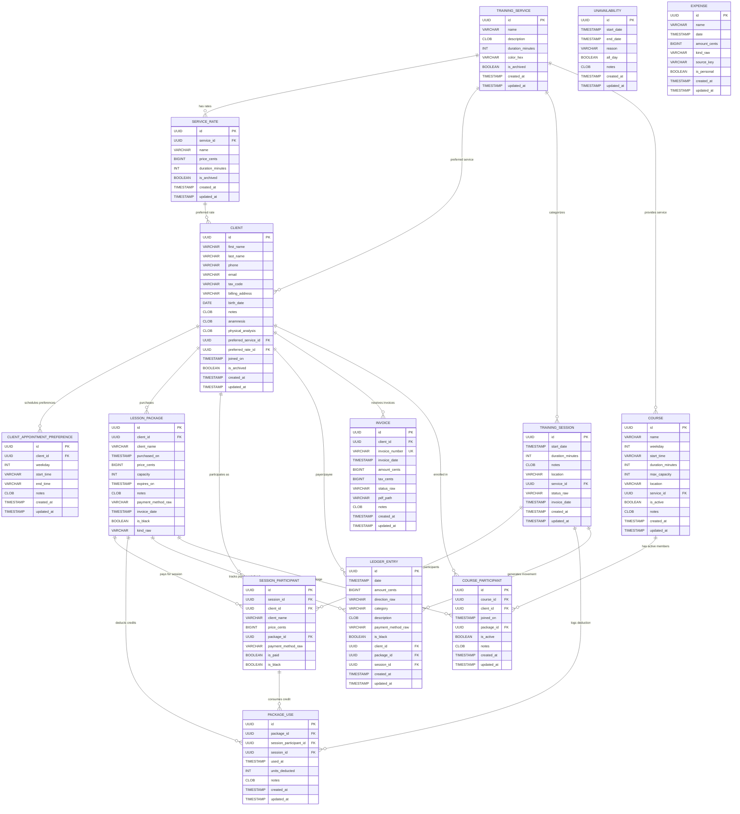

# Gestionale Paola - Database Architecture & Schema Status

This repository contains the consolidated, production-ready relational database schema and Liquibase migration scripts for **Gestionale Paola**, synthesized from SwiftData evolutionary versions V1 through V16.

---

## Graphical Database Entity-Relationship Diagram (ERD)




---

## Tables & Schema Reference (14 Tables)

| # | Table Name | Purpose | Primary Key | Key Foreign Keys | Key Indexes |
|---|------------|---------|-------------|------------------|-------------|
| 1 | `training_service` | Catalog of training disciplines/services | `id` (UUID) | - | - |
| 2 | `service_rate` | Service pricing tiers & durations (V3) | `id` (UUID) | `service_id` &rarr; `training_service` | `idx_service_rate_service` |
| 3 | `client` | Client personal details, tax code, medical notes & anamnesis | `id` (UUID) | `preferred_service_id`, `preferred_rate_id` | `idx_client_name_archived`, `idx_client_pref_service`, `idx_client_pref_rate` |
| 4 | `client_appointment_preference` | Recurring weekly preferred time slots (V4) | `id` (UUID) | `client_id` &rarr; `client` | `idx_client_pref_client_weekday` |
| 5 | `training_session` | Individual/group booked appointments | `id` (UUID) | `service_id` &rarr; `training_service` | `idx_training_session_start`, `idx_training_session_service`, `idx_training_session_calendar` |
| 6 | `lesson_package` | Prepaid multi-lesson & time packages (V1-V16) | `id` (UUID) | `client_id` &rarr; `client` | `idx_lesson_package_client`, `idx_lesson_pkg_client_expires` |
| 7 | `session_participant` | Join table for session attendees with payment tracking | `id` (UUID) | `session_id`, `client_id`, `package_id` | `idx_session_part_session`, `idx_session_part_client`, `idx_session_part_package` |
| 8 | `package_use` | Audit log of package credit deductions | `id` (UUID) | `package_id`, `session_participant_id`, `session_id` | `idx_package_use_pkg`, `idx_package_use_session_part`, `idx_package_use_session` |
| 9 | `ledger_entry` | Double-entry / cash accounting entries | `id` (UUID) | `client_id`, `package_id`, `session_id` | `idx_ledger_entry_date`, `idx_ledger_entry_client`, `idx_ledger_entry_pkg`, `idx_ledger_entry_session`, `idx_ledger_reporting` |
| 10 | `unavailability` | Trainer calendar blocks & holidays | `id` (UUID) | - | `idx_unavailability_range` |
| 11 | `invoice` | Client billing documents & PDF attachments (V8) | `id` (UUID) | `client_id` &rarr; `client` | `uk_invoice_number` (UK), `idx_invoice_client`, `idx_invoice_date`, `idx_invoice_client_date` |
| 12 | `expense` | One-time and recurring business/personal expenses | `id` (UUID) | - | `idx_expense_date`, `idx_expense_reporting` |
| 13 | `course` | Recurring group courses by weekday (V14) | `id` (UUID) | `service_id` &rarr; `training_service` | `idx_course_service`, `idx_course_weekday` |
| 14 | `course_participant` | Active student course enrollments (V14) | `id` (UUID) | `course_id`, `client_id`, `package_id` | `uk_course_part_course_client` (UK), `idx_course_part_course`, `idx_course_part_client`, `idx_course_part_package` |

---

## Performance Indexes & Integrity Optimizations

1. **Foreign Key Indexing**: Every single foreign key constraint across all 14 tables has an accompanying B-Tree index to ensure joins execute in $O(\log N)$ time and avoid sequential table locking during cascade deletions.
2. **Filtered & Composite Query Optimization**:
   - `idx_client_name_archived (is_archived, last_name, first_name)`: Instant dropdown rendering and client search without table scanning archived records.
   - `idx_training_session_calendar (start_date, status_raw)`: Rapid calendar rendering across date windows filtering canceled appointments.
   - `idx_ledger_reporting (date, direction_raw, is_black)`: Rapid monthly and annual tax/revenue accounting summaries.
   - `idx_expense_reporting (date, is_personal)`: Fast calculation of deductible business expenses.
   - `idx_unavailability_range (start_date, end_date)`: Instant calendar collision detection during appointment booking.
3. **Data Integrity Constraints**:
   - Unique invoice numbers via `uk_invoice_number`.
   - Unique course client enrollment via `uk_course_part_course_client (course_id, client_id)`.
   - Explicit cascading delete rules (`CASCADE` vs `SET NULL`) matching business domain invariants.

---

## Liquibase Commands & Verification

### Running Schema Migrations
```bash
# Execute schema migration against the configured database
mvn liquibase:update

# Validate changelog syntax and checksum integrity
mvn liquibase:validate

# Preview generated SQL without modifying the database
mvn liquibase:updateSQL

# Drop all database objects (clean environment)
mvn liquibase:dropAll
```

    CLIENT ||--o{ CLIENT_APPOINTMENT_PREFERENCE : "schedules preferences"
    CLIENT ||--o{ LESSON_PACKAGE : "purchases"
    CLIENT ||--o{ SESSION_PARTICIPANT : "participates as"
    CLIENT ||--o{ LEDGER_ENTRY : "payer/payee"
    CLIENT ||--o{ INVOICE : "receives invoices"
    CLIENT ||--o{ COURSE_PARTICIPANT : "enrolled in"

    TRAINING_SESSION ||--o{ SESSION_PARTICIPANT : "contains participants"
    TRAINING_SESSION ||--o{ PACKAGE_USE : "logs deduction"
    TRAINING_SESSION ||--o{ LEDGER_ENTRY : "generates movement"

    LESSON_PACKAGE ||--o{ SESSION_PARTICIPANT : "pays for session"
    LESSON_PACKAGE ||--o{ PACKAGE_USE : "deducts credits"
    LESSON_PACKAGE ||--o{ LEDGER_ENTRY : "tracks purchase/refund"
    LESSON_PACKAGE ||--o{ COURSE_PARTICIPANT : "linked package"

    SESSION_PARTICIPANT ||--o{ PACKAGE_USE : "consumes credit"
    COURSE ||--o{ COURSE_PARTICIPANT : "has active members"
```
