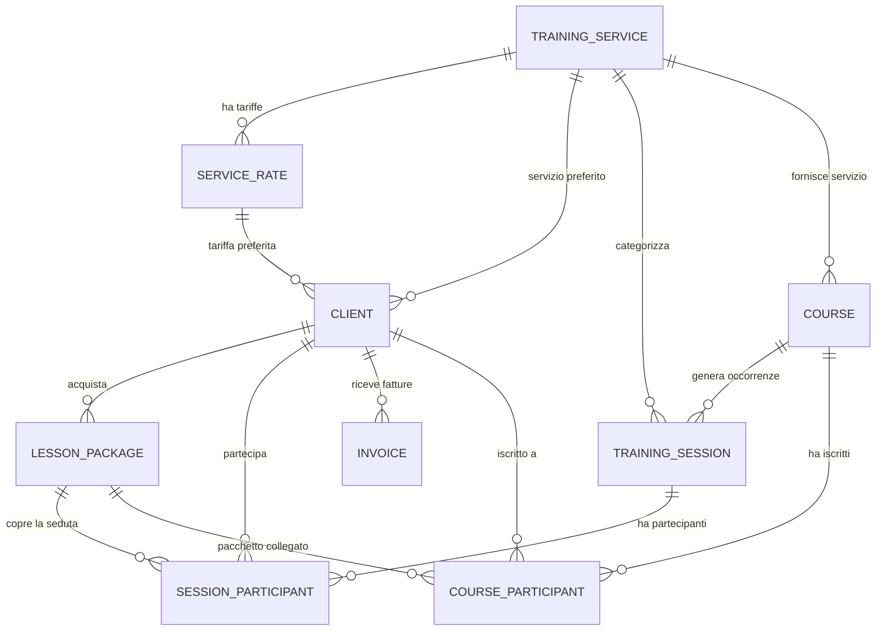

# Gestionale Paola - Backend

Backend per **Gestionale Paola**, costruito con **Quarkus**, **Hibernate Panache** e
**PostgreSQL**. Serve l'app nativa **paola_gestionale** (SwiftUI, macOS/iOS): gestione
servizi di training, agenda clienti, pacchetti prepagati e contabilità.

## 🚀 Quick Start

### Prerequisiti
- Java 21
- Maven 3.9+
- PostgreSQL (produzione/remoto) o H2 (sviluppo locale)

### Dev mode (hot reload, H2 locale)
```bash
./mvnw quarkus:dev
```
API su `http://localhost:8080/api`. Swagger UI su `http://localhost:8080/q/swagger-ui`.

### Test
```bash
./mvnw test
```

### Migrazioni database
Lo schema è gestito da **Liquibase** (eseguito automaticamente all'avvio in dev/test).
```bash
./mvnw liquibase:update     # applica
./mvnw liquibase:validate   # valida checksum
```

---

## 🏗️ Architettura

### Tech Stack
- **Framework**: [Quarkus](https://quarkus.io/)
- **ORM**: [Hibernate ORM with Panache](https://quarkus.io/guides/hibernate-orm-panache) (active record)
- **Database**: PostgreSQL (produzione), H2 (dev/test)
- **Migrazioni**: [Liquibase](https://www.liquibase.org/)
- **Linguaggio**: Java 21
- **Extra**: OpenAPI/Swagger, Hibernate Validator, SmallRye Health, CORS

### Principi di design
- **Resource orientate alle view** dell'app, non specchio delle tabelle: il contratto
  HTTP rispecchia ciò che ogni schermata chiede.
- **Contabilità derivata**: nessuna tabella ledger. Saldi e incassi si calcolano dagli
  eventi (`saldo = addebiti netti − incassi netti`).
- **Crediti pacchetto derivati**: nessuna tabella di consumo; residui calcolati dalle
  presenze alle sessioni completate.
- **Corsi come sessioni**: `course` è il template di ricorrenza; le occorrenze sono
  `training_session` con `course_id`.
- **Denaro in centesimi** (`long`); enum tipizzati via converter; soft delete via `is_archived`.

---

## 🗺️ Stato & Roadmap

### Stato: 🏗️ Modello completo, API in costruzione
- [x] Schema database (12 tabelle) consolidato in Liquibase.
- [x] Entity Panache implementate e validate contro lo schema.
- [x] Profili dev/test/prod, CORS, OpenAPI, health.
- [ ] Resource per view + servizi di dominio (saldi, crediti, calendario).
- [ ] Reporting (incassi, ore lavorate, estratto conto, forfettario).
- [ ] Autenticazione/autorizzazione.

---

## 📊 Schema del database (11 tabelle)



| # | Tabella | Scopo |
|---|---------|-------|
| 1 | `training_service` | Catalogo discipline/servizi |
| 2 | `service_rate` | Tariffe e durate per servizio |
| 3 | `client` | Anagrafica, codice fiscale, anamnesi, preferenze di appuntamento integrate |
| 4 | `training_session` | Appuntamenti; occorrenza di corso se `course_id` è valorizzato |
| 5 | `lesson_package` | Pacchetti a lezioni o a tempo |
| 6 | `session_participant` | Partecipanti: prezzo, pacchetto, pagato, bianco/nero |
| 7 | `unavailability` | Blocchi calendario del trainer |
| 8 | `invoice` | Fatture clienti |
| 9 | `expense` | Spese aziendali/personali |
| 10 | `course` | Template di corsi ricorrenti settimanali |
| 11 | `course_participant` | Iscrizioni ai corsi |

### Note
- **Contabilità**: i movimenti non sono memorizzati. Addebiti/incassi di una lezione
  singola derivano da `training_session` (completata) + `session_participant`; l'acquisto
  pacchetto da `lesson_package`; le spese da `expense`. Incassi automatici solo in due
  casi (acquisto pacchetto, lezione singola non coperta da pacchetto).
- **Crediti pacchetto**: residui = `capacity − (partecipanti con quel pacchetto e sessione completata)`.
- Ogni foreign key ha un indice dedicato; indici composti su `training_session`
  (calendario), `client` (ricerca/archiviati), `unavailability` (collisioni).
